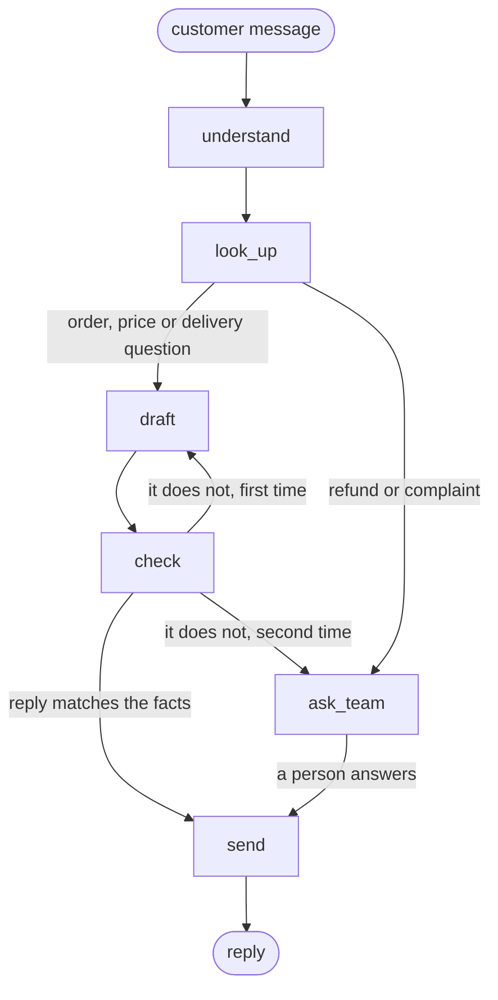

# support-desk-langgraph

[](https://github.com/vinhoth5/support-desk-langgraph/actions/workflows/tests.yml)

A customer help desk agent built on [LangGraph](https://github.com/langchain-ai/langgraph). It answers order, price and delivery questions for a made-up plant shop, checks every reply against the facts it looked up before sending it, and hands the conversation to a person when it should not answer on its own.

I build AI agents that talk to real customers. That work is private, so I wrote this small one to show how I approach the same problems in LangGraph. The shop, its products, its orders and its customers are all invented.

## What it does



- **understand** works out what the customer wants and pulls out an order number or pincode.
- **look_up** calls the shop's own functions. These are the only source of facts: an order is returned only to the customer it belongs to, and a pincode the shop does not cover returns nothing.
- **draft** asks the model to write a reply from those facts.
- **check** is a guard. It reads the draft and flags any price, order number, product or delivery date that did not come from the lookup, any out-of-stock item described as available, and any promise of a refund or replacement.
- **ask_team** pauses the graph with LangGraph's `interrupt()` and waits for a person. Refunds and complaints always go here. So does a draft that failed the check twice.
- **send** adds the reply to the conversation.

Each conversation is a LangGraph thread with a checkpointer behind it. That is what lets "any update on my parcel?" work without repeating the order number, and what lets a thread sit paused until the team answers.

## Run it

Python 3.11 or newer.

```bash
git clone https://github.com/vinhoth5/support-desk-langgraph.git
cd support-desk-langgraph
pip install -e ".[dev]"

python -m supportdesk --demo     # a scripted conversation
python -m supportdesk --rules    # the rule check
python -m supportdesk            # chat with it yourself
pytest                           # the test suite
```

None of this needs an API key. By default the two model jobs (understanding a message, writing a reply) are done by a small rule-based stand-in, so the graph gives the same answer every time and the tests mean something.

To put a real model behind it:

```bash
pip install -e ".[llm]" langchain-openai      # or any other LangChain provider package
export OPENAI_API_KEY=...
export SUPPORTDESK_MODEL="openai:gpt-4o-mini"
python -m supportdesk
```

`SUPPORTDESK_MODEL` is passed to LangChain's `init_chat_model`, so any provider it supports will work. The graph, the guard and the handoff stay exactly the same.

## The demo

```
Customer: Where is my order FH5001?
Desk:     Order FH5001 (Monstera Deliciosa) is out for delivery with Northline Express. The last scan says it reached the local hub.

Customer: Any update on my parcel?
Desk:     Order FH5001 (Monstera Deliciosa) is out for delivery with Northline Express. The last scan says it reached the local hub.

Customer: Do you have the fiddle leaf fig?
Desk:     Fiddle Leaf Fig is ₹1,499 and out of stock right now.

Customer: How long will it take to deliver to 560034?
Desk:     Delivery to 560034 takes about 2 days, so an order placed today should arrive around 15 Nov.

Customer: I want a refund for order FH5002
  [handed to the team: Refunds and complaints are decided by a person.]
Team:     We've approved a full refund for FH5002. It will reach you in 3 to 5 working days.
Desk:     We've approved a full refund for FH5002. It will reach you in 3 to 5 working days.
```

## The rule check

The part I care about most is `supportdesk/rulecheck.py`. It lists the things this desk must never get wrong, and each one is a short conversation played against the real graph.

```
  pass  Order status comes from the order record
  pass  An unknown order number is not guessed
  pass  Another customer's order stays private
  pass  Prices match the catalogue
  pass  Out-of-stock items are not offered as available
  pass  Delivery dates come from the pincode table
  pass  No date is promised for an uncovered pincode
  pass  Refund requests go to a person
  pass  Complaints go to a person
  pass  The team's answer reaches the customer, and the chat carries on
  pass  A new message does not drop a question the team has not answered
  pass  A follow-up remembers the order
  pass  A wrong price in a draft is caught and rewritten
  pass  A draft that cannot be fixed goes to a person

14 of 14 rules passed
```

Anyone changing a prompt or swapping the model can run this first and see whether the agent still behaves. The last two rules use a scripted model that deliberately writes a wrong price, to prove the guard and the retry loop do their job.

## Why it is built this way

**The model never touches the shop's data directly.** It gets facts from `look_up` and nothing else. When a lookup finds nothing, the wording of the "not found" reply is fixed in code, so there is no gap for the model to fill with a guess.

**The guard is narrow on purpose.** It does not judge tone or helpfulness. It only asks whether the reply states something specific that the facts do not support. A narrow check is one I can test, and a wrong price or a wrong delivery date is the kind of mistake that costs a customer's trust.

**People decide anything involving money or an unhappy customer.** The agent gathers the order details so the person has them in front of them, then stops. What the person writes goes out as written.

**The model sits behind two small functions.** `understand` and `write` are the only places a model is called. That is why the whole graph can be tested without a key, and why a model can be swapped without touching the flow. If a real model ignores the JSON format, `understand` falls back to the rule-based version, so a formatting slip does not take the desk down.

## Where things are

| File | What is in it |
| --- | --- |
| `supportdesk/graph.py` | The LangGraph state, nodes and edges, and a small `Desk` wrapper |
| `supportdesk/guard.py` | The check that compares a draft with the facts |
| `supportdesk/models.py` | The rule-based stand-in and the LangChain chat model wrapper |
| `supportdesk/shop.py` | The invented shop: catalogue, orders, delivery times |
| `supportdesk/rulecheck.py` | The rules, as runnable conversations |
| `tests/` | Tests for the guard, the rules and the chat model path |

## What it does not do yet

- Conversations are kept in memory and are gone when the process stops. LangGraph's SQLite or Postgres checkpointers would fix that.
- A message that arrives while a thread is waiting for the team gets a holding reply and is not stored. It should be queued and answered after the handoff.
- The chat model path is tested with a fake model. It has not been measured against the rule check on a live provider.
- The guard works on patterns it knows: prices, order numbers, dates, product names, a few promise words. A real shop would need more of them.
- There is one channel, the terminal.

## About

Built by [Vinhoth D Mohanraj](https://www.linkedin.com/in/vinhoth-d-mohanraj-051950102/), using AI coding agents, which is how I build. MIT licensed.
